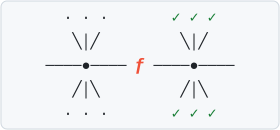

# SwiftFormal

<p align="center">
  
</p>

A formal verification library for Swift. It checks that your code keeps its promises for every input, not only the
few inputs your tests try.

You write the promise in plain Swift, next to the function. When you build, SwiftFormal either proves the promise
holds or shows you the exact input that breaks it.

## How to use it

1. **App code: write the promise in the function.** `import SwiftFormal`, mark the function `@Verify`, and write
   `#requires` and `#ensures` inside it ([quick start](#quick-start)):

```swift
@Verify(over: .product(.int(0...1_000), .int(0...100)))
public func discounted(price: Int, percent: Int) -> Int {
    #requires(price >= 0 && price <= 1_000_000 && percent >= 0 && percent <= 100)
    #ensures { $0 >= 0 && $0 <= price }
    return price - price * percent / 100
}
```

2. **Tests, only where the logic cannot read the code: `Prove`.** `import SwiftFormalTesting` and walk the real
   function over every input you list, with what must hold written like SwiftUI views
   ([`Examples/Walk`](Examples/Walk)):

```swift
Prove(it: { label(for: $0) }, over: .allCases) {
    Deterministic()
    Matches(table: [
        .standard: "Standard (3-5 days)",
        .express: "Express (1-2 days)",
        .overnight: "Overnight",
    ])
    Satisfies("never blank") { _, text in !text.isEmpty }
}
```

   A reducer or a model, every sequence of actions:

```swift
Prove(it: { BasketReducer().reduce(into: &$0, action: $1) }, over: .sessions(from: Basket(), actions: .allCases, upTo: 4)) {
    Always("1 to 9 items") { (1...9).contains($0.quantity) }
}
```

   A function that may crash, walked in a child process so a crash names its input:

```swift
await Prove(neverTraps: DeliveryDays.self)
```

3. **Run `swiftformal check`.** It proves with logic first and runs only the `Prove` walks logic could not replace.
   As a build step (an Xcode Run Script phase, or CI), `swiftformal check --gate` fails the build on a broken promise:

```sh
swiftformal check --scan .:MyTarget --tests .:MyTargetTests
swiftformal check --gate
```

There is no other entry point. Names from before 0.1.0 do not compile, and the compiler says what to write instead
([migrating](docs/guides/walk.md#migrating-from-the-pre-release-names)).

## Why you need it

Code, especially code written with AI, usually works for the examples someone tried. The bugs hide in the inputs
nobody tried: a number that overflows, an index out of range, an enum case mapped to the wrong text, a `Double`
that is NaN. Tests check a few inputs, and review misses the rest. When AI writes most of the code, there is more
code than anyone can read carefully.

SwiftFormal checks **all** the inputs:

- **No crashes.** It proves a function cannot crash (overflow, bad index, bad conversion). You add nothing.
- **Kept promises.** It proves your `#requires` and `#ensures` hold for every input.
- **Exact answers.** When something is wrong, you get the input that breaks it, ready to paste into a test.
- **Honest.** When it cannot decide, it says so. It never says "proved" by guessing.

On a real iOS app with about 10,500 functions, the first runs proved about 4,800 of them cannot crash, and found:

- a `Double` to `Int` conversion that crashes on large values;
- an array read with an index nobody checked;
- a promise that was wrong when a value is NaN.

## How it works

1. **You write a promise** with `#requires` (what the inputs must be) and `#ensures` (what the result must be).
2. **You build.** SwiftFormal reads what the Swift compiler made of your function and turns it into logic.
   A solver tries every possible input. A second, independent checker confirms each proof.
3. **You run the tests.** Code that the logic cannot read yet (classes, most closures, generic code) is checked by
   running the real function on every input you listed.

Each function gets one answer:

| Answer | Meaning |
|---|---|
| `proved` | Holds for every input. |
| `counterexample` | Broken, and here is the input. |
| `bounded` | Held for every input that was checked, but not every input was checked. |
| `unchecked` | SwiftFormal cannot read this code yet, and says why. |

## Quick start

**1. Add the package.** There are two libraries and one command: `SwiftFormal` for app code
(`import SwiftFormal`), `SwiftFormalTesting` for test targets (`import SwiftFormalTesting`), and the `swiftformal`
command:

<!-- not from Examples -->
```swift
dependencies: [.package(url: "https://github.com/sorunokoe/SwiftFormal.git", from: "0.1.0")],
targets: [
    .target(name: "Shop", dependencies: [.product(name: "SwiftFormal", package: "SwiftFormal")]),
    .testTarget(name: "ShopTests", dependencies: ["Shop", .product(name: "SwiftFormalTesting", package: "SwiftFormal")]),
]
```

**2. Write a promise** ([`Examples/Verify`](Examples/Verify)):

```swift
@Verify(over: .product(.int(0...1_000), .int(0...100)))
public func discounted(price: Int, percent: Int) -> Int {
    #requires(price >= 0 && price <= 1_000_000 && percent >= 0 && percent <= 100)
    #ensures { $0 >= 0 && $0 <= price }
    return price - price * percent / 100
}
```

`$0` is the result. `over:` lists the inputs a test walks (step 4); the logic checks all inputs anyway.
An enum or `Bool` parameter needs no `over:`, and without `over:` a `String` or `Int` function gets no walk: the
logic alone checks it. A computed property keeps its promise in the getter, the same way:

```swift
@Verify
public var label: String {
    #ensures { !$0.isEmpty }
    items == 0 ? "Empty basket" : "Basket"
}
```

**3. Check it.** Build the command once, in the SwiftFormal checkout:

```sh
git clone https://github.com/sorunokoe/SwiftFormal.git && cd SwiftFormal
swift build -c release --product swiftformal
```

Then run `swiftformal check --gate --package <your package>`. Change `/ 100` to `/ 99` and it fails, with the input:

```text
Shop.swift:5:13: error: [SwiftFormal] discounted(price:percent:) breaks its promise: ensures failed: { $0 >= 0 && $0 <= price } when price = 524288, percent = 100
Shop.swift:5:13: note: [SwiftFormal] replay: discounted(price: 524288, percent: 100)
```

Add the same command as a Run Script phase in Xcode, and ⌘B shows the error on the function's line.
CI runs the same command and gets the same answer ([setup](docs/guides/gate.md)).

**4. Test it.** `@Verify` also writes a `verify_discounted()` walk for your tests:

```swift
@Test func discountStaysInRange() {
    #expect(verify_discounted().isProved)
}
```

## Check every case of a rule

For mappers and rules (an enum in, text out), list what each case must give
([`Examples/Walk`](Examples/Walk)). A missing or wrong row is a counterexample:

```swift
@Test func everySpeedHasItsLabel() {
    Prove(it: { label(for: $0) }, over: .allCases) {
        Deterministic()
        Matches(table: [
            .standard: "Standard (3-5 days)",
            .express: "Express (1-2 days)",
            .overnight: "Overnight",
        ])
        Satisfies("never blank") { _, text in !text.isEmpty }
    }
}
```

More: the [Walk guide](docs/guides/walk.md).

## Find crashes in code with no promises

```sh
swiftformal check --scan .:MyTarget --tests .:MyTargetTests
```

This checks every function in `MyTarget`. Each one is either proved unable to crash, shown crashing with an input,
or covered by a test that runs it. `--xcode` prints the answers as compiler errors and warnings, `--json` gives
them to scripts, and `--at File.swift:42` checks one function. More: the [Scan guide](docs/guides/scan.md).

## Where it fits

- **Xcode and CI:** `swiftformal check --gate` as a build step, also for an app target from its build log
  (`--build-log`; [Gate guide](docs/guides/gate.md)).
- **VS Code and Neovim:** `swiftformal lsp` shows `✓ proved` or `✗ counterexample` above each function as you save ([Editor guide](docs/guides/editor.md)).
- **AI agents:** copy [`skills/swiftformal`](skills/swiftformal/SKILL.md) into your agent's skills folder. The agent
  then checks its own code and fixes what is broken. To change SwiftFormal itself, read [AGENTS.md](AGENTS.md).
- **Setup problems:** `swiftformal doctor` finds them and says how to fix each one.
- **Localization:** `swiftformal strings <path>` finds missing translations and format arguments that do not match
  (`%d` where another language has `%@`).

## What it can read today

The logic reads value code: integers, `Double`, `Bool`, `String`, enums, structs, optionals, and common Foundation
values such as `Date`, `URL` and `UUID`. It does not read most classes, closures or generic code yet. There it
says `unchecked`, and a test covers it. See [known issues](docs/KNOWN-ISSUES.md).

Needs Swift 6.1 or newer. The library runs on macOS 13 and iOS 16. The checks run on a Mac ([platforms](docs/guides/platforms.md)).

Also included in `SwiftFormalTesting`, as a preview: [symbolic proofs](docs/guides/prove.md) (`proveSigned`) over
whole integer ranges.

## How much to trust it

A test runs your real function, so you trust only the compiler and the inputs you listed. The logic adds a model of
Swift. It is tested against real runs, but it is not itself proved correct. Details: [What you have to trust](docs/TRUST.md).

## Learn more

- [Mental model](docs/MENTAL-MODEL.md) and [glossary](docs/GLOSSARY.md): every answer word explained.
- [Architecture](docs/ARCHITECTURE.md), [what scales](docs/SCALING.md) and [performance](docs/PERFORMANCE.md).
- [How we got here](archive/README.md): the research and prototypes.

## Contributing

Start with [CONTRIBUTING.md](CONTRIBUTING.md), and run `Scripts/safety-net.sh` before you commit (it must end with
`SAFETY NET GREEN`). A wrong `proved` is the worst bug here: please [report it](SECURITY.md) right away.
Please also read the [Code of Conduct](CODE_OF_CONDUCT.md). Release steps: [RELEASING](docs/RELEASING.md).

## License

[Apache-2.0](LICENSE).
